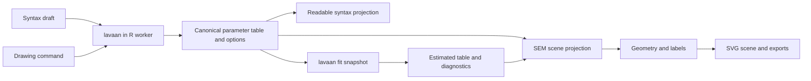

# Proposed architecture · Phase 0 review

This is a proposal for review, not a description of implemented application
modules. Phase 0 has demonstrated native/WASM numerical equivalence under
Node.js, Firefox 159, and embedded Chromium/Electron. Both browser runs were
opened by the user. Chrome/Edge/Safari numerical checks and the full application
compatibility matrix remain v1 release gates.

## Product and technology choice

Use TypeScript, React, Vite, SVG and CodeMirror 6. Use the now-tested webR
0.6.0/lavaan 0.7-3 combination, packaged as an immutable R library image.
The initial analysis preset is SEM; CFA remains explicit. Target current
desktop Chrome, Edge, Firefox and Safari, with their exact tested versions
recorded at release. Mobile support is not part of the initial performance
commitment.

React is an ordinary implementation choice; Svelte would also work. Rendering
and layout must be framework-independent. ELK.js is a proposed structural
placement component, not a promise of finished SEM layout. Its layered
algorithm supports ports, labels and several routing styles, but does not
encode all SEM conventions. [ELK layered reference](https://eclipse.dev/elk/reference/algorithms/org-eclipse-elk-layered.html).

Use a static-host-compatible PostMessage R worker by default. Cancellation
closes the worker and restores its state in a new instance. A host with
isolation headers could later offer SharedArrayBuffer for better interruption,
without making that a deployment requirement. Freeze the runtime, packages,
fonts and licenses into an immutable build artifact before calling the app
reproducible or offline-capable.
[webR channels](https://docs.r-wasm.org/webr/latest/communication.html).

If the remaining release-browser checks fail, propose Tauri plus a local R subprocess using the
same typed protocol and project format. Do not implement that switch without
the user's decision. The measured browser-engine spike succeeded; automation
access itself is still unavailable in this environment.

## The canonical scientific model

The semantic authority is a **complete lavaan parameter table plus the
analysis options and lavaan-generated constraints/attributes needed to
interpret it**. A flat subset of `lhs/op/rhs` columns is insufficient.

Store the following in a versioned, open project document:

| Part | Contents and purpose |
|---|---|
| Model | Canonical rows including group/block/level, free/fixed state, starts, labels, bounds, definitions and constraints; preserve relevant lavaan attributes. |
| Options | CFA/SEM preset, resolved auto-parameter settings, marker/scale choices, `fixed_x`, meanstructure, group count/order, ordered-variable metadata and estimator settings. |
| Provenance | Explicit syntax rows, automatically added rows, and default-applied attributes; source order and comments as presentation metadata. |
| Identity | Stable app IDs matched to semantic row/node keys; do not use row number, `free` index or parameter label as an immutable ID. |
| View | Positions, user locks, label offsets, covariance bends, group panels, theme and viewport. Geometry changes never modify model parameters. |
| Fit | Input model/data/options fingerprint, package/runtime versions, estimates, SEs, `std.all`, R², diagnostics and result tables. Mark stale after any scientific change. |
| Draft | Optional unsaved/invalid editor text and parse diagnostics; it does not replace the last valid canonical model. |

Row keys include block, group, level, lhs, op and rhs. Covariance pair order
is normalised for matching, while written order is retained separately.
Constraints and generated parameter labels are mapped back to stable rows.
Handle duplicate/ambiguous matches explicitly rather than attaching a saved
position or estimate to a different parameter.

`user=0` identifies many auto-added rows, but **is not enough for provenance**:
lavaan can fix the first loading of an explicitly supplied row. Compare
lavaan's own explicit parse/metadata with the expanded table and record
attribute-level defaults. Do not reconstruct this with regular expressions.
In Phase 0, the reference studies know their fixed fixtures; their marker
styling is not the production provenance implementation.

After fitting, re-extract the authoritative table from the fitted object:
ordered thresholds and data-dependent choices may add detail. Display the
updated provenance and never silently reinterpret an earlier diagram.
When `std.all` is selected, display its actual standardised marker loading;
an unstandardised loading fixed to 1 need not be 1 after standardisation.

## Syntax and drawing round trips

1. Debounce syntax edits, send the text as an R character value to lavaan,
   and compile with the selected preset/options. Editor tokenisation provides
   colour and completion only; it never decides scientific meaning.
2. On success, validate supported constructs and commit one canonical
   transaction. On error, retain the previous model with a visible pending
   or invalid state and the original lavaan diagnostic. Fit/export must not
   imply that an invalid draft is the model shown.
3. A drawing command changes a candidate table/options transaction. R validates
   and normalises it before commit. GUI edits to implicit parameters become
   explicit overrides with recorded provenance.
4. Generate readable syntax grouped into measurement, structural, covariance,
   mean/threshold, definition and constraint sections. Keep necessary
   modifiers, `NA*`, multigroup vectors and fixed zeros. Generated syntax is
   a semantic projection; exact original whitespace/comments are not promised.
5. Reparse the generated syntax with the same lavaan options and compare the
   normalised table, constraints and bounds. Reject a lossy round trip.

No custom lavaan parser is introduced. Labels and names must be escaped via
the supported R/JS value APIs, not interpolated into executable R snippets.
All interface strings belong to locale resources. In this spike they live
in `spike/en.json`; review figure strings live in `fixtures/reference.en.json`.

Single-group syntax does not determine intended group count, and absent data
cannot determine how many ordinal thresholds an item needs. Provide document
settings for both. Render explicit thresholds now and mark unknown counts;
never fabricate categories to make a diagram appear complete.

## Layout as a constrained pipeline

The engine operates on the semantic projection, not editor text or a fitted
object. Each drawable row must map to a scene object or a named annotation.
Unknown operators stop conversion with a diagnostic; no silent omission.

1. **Classify the graph.** Separate measurement relations, regressions,
   residual variances, exogenous covariances, intercepts, thresholds,
   definitions and constraints. A displayed residual circle is derived view
   structure for a canonical variance row, not a newly invented parameter.
2. **Decompose before placing.** Find regression layers and measurement
   clusters. Collapse cycles for analysis, detect mediation triangles,
   second-order hierarchies, cross-loadings, composites and single-indicator
   factors. Do not treat all measurement arrows as structural ranks.
3. **Generate candidate skeletons.** Use ELK for the structural portion and
   explicit SEM templates for common measurement clusters and mediation.
   Preserve lavaan's written indicator order. Consider left/right or
   above/below outer-side cluster orientations against the overall flow.
4. **Expand measurement clusters.** Place indicators with even spacing;
   reserve the outer gutter for residual circles and their fixed-1 paths.
   Second-order factors form nested measurement clusters. Cross-loadings
   remain shared nodes, not duplicated observations. Composites get an
   explicit type annotation and the correct arrow direction.
5. **Route covariance arcs.** Exclude them from structural ranking, then
   allocate outside lanes around inflated node bounds. Route a residual
   covariance between residual circles in Amos mode. Evaluate crossings and
   choose lanes/orientations together; adding curves after positioning alone
   cannot guarantee a good result.
6. **Place labels with measured fonts.** Measure the actual glyph bounds
   including Greek symbols and subscripts. Try candidates beside each path
   with clearance from nodes, arrowheads, other labels and unrelated strokes.
   Expand gutters or revisit the layout if no valid candidate exists.
7. **Validate and score.** Hard checks: node intersections, nonincident
   edge–node intersections, label intersections, clipped text and missing
   semantic objects. Soft costs: edge crossings, long arcs, asymmetry,
   excess area and displacement. Use deterministic seeds and tie-breaks.
8. **Commit the scene.** Freeze coordinates and style into an exportable
   scene representation. Pan/zoom transform the viewport, not the model.

Do not claim zero crossings for arbitrary dense graphs; that is impossible
in general. The target is zero avoidable node/label collisions and minimised
edge crossings for the supported families, demonstrated on fixtures. Valid
feedback models also cannot have every regression point strictly rightward.
Until that layout family is implemented, give an explicit unsupported-layout
message rather than silently drawing a misleading acyclic model.

## Stability and manual control

Keep manually locked nodes fixed. Preserve all existing node coordinates on
ordinary edits; place new nodes in free slots around their semantic cluster
and route new edges around the existing scene. Adding an indicator need not
globally redistribute existing ones: its new slot may extend the cluster.

If existing positions leave no collision-free space, report the conflict and
offer an explicit **reflow affected cluster** action. That action, and only
that action, may move unlocked existing nodes. The promises of immutable
positions, perfectly even spacing after every insertion and no collisions
cannot always hold simultaneously; make that tradeoff visible.

Geometry has its own undo history within atomic project transactions. A fit
annotation or locale change must not move nodes. Changing label size may
require extra space; preserve locks and report unresolved conflicts.

## Worker and results boundaries

Use a typed request/reply protocol with request IDs, model revisions and
structured diagnostics. Start with one persistent R worker and a serial job
queue. Coalesce pending parse requests. The main UI remains responsive while
R fits; a new syntax draft is visibly pending rather than apparently synced.
Only apply replies whose revision matches their snapshot.

Cancellation terminates the worker in PostMessage mode. Retain the last
canonical document and input data in app memory, then restore the worker on
demand. A separate parser worker is a later option only if measured memory
budgets justify loading a second R runtime. Release temporary R objects with
webR shelters and avoid serialising entire datasets for every syntax edit.

Use lavaan for ML/MLR/WLSMV, FIML, bootstrap, modification indices and nested
tests; do not reproduce estimation algorithms in TypeScript. Test combinations
explicitly. Ordinal/WLSMV analyses must not silently inherit unsupported
missing-data or bootstrap options. Invariance comparisons use the correct
lavaan scaled difference test rather than subtraction of robust χ² values.

CSV, Excel and SPSS imports need a separate WASM-compatibility spike in
Phase 2. Preserve labels, missing values and ordered types. Verify `readxl`
and `haven` availability before promising those imports in browser R; a
dedicated local JS reader is an alternative with its own fidelity tests.
Covariance-matrix input includes N, variable order and optional mean/threshold
information. No estimation proceeds if required metadata are missing.

The Data workspace is a first-class part of the analysis application. It must
show the imported cases in a spreadsheet-style viewer, with variable names and
labels, measurement types, category/value labels and missing-value indicators.
Users need case/variable counts, variable summaries, column navigation and a
responsive viewer for datasets larger than the visible grid. The Model and
Results workspaces use the same dataset revision. The existing data-free
converter remains available as one workflow within this application. Detailed
Phase 2 requirements and review checks are in [phase-2.md](phase-2.md).

Use existing, documented R tooling for reliability/omega, AVE, HTMT and
invariance syntax where feasible, after confirming WASM support. Results
need method labels and diagnostics for inadmissible solutions and unsupported
model types. An MI “add” command previews a canonical change and requires a
new fit; it never implies that a data-suggested change is substantively justified.

## One scene for screen and export

The scene contains paths, node shapes, exact text metrics and typography.
SVG is the primary representation. PNG rasterises that same SVG at a chosen
physical size/DPI; PDF preserves vectors/fonts; TikZ serialises identical
scene coordinates and semantics. Greek notation uses local, licensed fonts
or pre-typeset SVG glyph groups, avoiding browser-dependent HTML overlays.

Investigate upstream lavaan's SVG/TikZ exporters before implementing those
parts again. They must reproduce the approved scene; a separately recomputed
R layout is not sufficient. APA tables use the same result data as the UI,
with a Word-compatible export and LaTeX output. No HTML-only clipping,
selection chrome or viewport scaling enters exported figures.

Export validation is both semantic and visual: correct arrows/labels/groups,
font embedding or outlined glyphs, legible figure-size text, complete bounds,
and comparison against the on-screen scene. Keep fitted values at full
precision internally and apply rounding only at display/export.

## Module plan and phase gates

| Module | Responsibility | Meaningful verification |
|---|---|---|
| `r-runtime` | Pinned webR lifecycle, requests, value transport, cancellation | Actual browser install and HS fit on all four target browsers; restart a long job. |
| `lavaan-adapter` | Compilation, complete table/options/constraint schema, provenance | Native/WASM equality; implicit defaults; unsupported-construct diagnostics. |
| `model-core` | Stable identities, transactions and project migration | Round-trip semantic equivalence; group/constraint preservation; undo integrity. |
| `sem-layout` | Skeleton, measurement placement, covariance routing, labels | Fixed seven-model snapshots, collision metrics, deterministic output and edit stability. |
| `svg-scene` | Accessible SVG and consistent geometry | Shape/arrow/text coverage, bounds and original-size visual review. |
| `editor` | Highlighting, dataset names, lavaan diagnostics, pending states | Invalid text never changes the committed model or mislabels a fit. |
| `data-workspace` | Import, spreadsheet viewer, variable metadata and dataset revision | Displayed cells/types/labels/missing values match the source; the fitted rows and variables are explicit. |
| `analysis` | Import, fit snapshots, estimates and result tables | Native R golden comparisons with pinned data/options/versions. |
| `export` | Figure and APA table outputs, reproducible R script | Reopen/export rendering and scientific content checks. |

| Phase | Deliverable and stop condition |
|---|---|
| **0** | Prior-art review, browser installation/HS fit, measured startup, architecture and seven studies. Completed in Firefox and embedded Chromium/Electron; full release-browser coverage remains open. Stop for review. |
| **1** | Data-free converter for the requested construct families; SVG scene, implicit-parameter toggle, diagnostic handling and excellent automatic layouts. All seven auto-rendered fixtures reviewed; geometry/stability assertions pass. Stop for review. |
| **2** | Imports, spreadsheet-style data viewer, variable metadata, fitting, annotations/results; first three browser estimates agree with native R to four decimals, including `std.all`. No silent estimator/missing-data substitution. Stop for review. |
| **3** | Drawing, parameter editing, dataset dragging, semantic two-way sync, project persistence and undo/redo. Round-trip tables/constraints match after every supported GUI operation. Stop for review. |
| **4** | Invariance, bootstrap, MI actions, reliability/validity output, SVG/PNG/PDF/TikZ, APA exports, themes and notation. All fixtures and export typography reviewed. Stop for review. |

The fixed fixtures are in `fixtures/models.json`. Additional Phase 1 cases
must include long labels, cross-loadings, fixed zero paths, shared labels,
free first loadings, formative constructs, thresholds, nonlinear constraints,
malformed syntax and insertion/deletion without node drift. These extend the
seven core fixtures rather than replacing them.

The phrase “any valid lavaan model” exceeds the enumerated v1 scope: current
lavaan also supports multilevel and other constructs outside the requested
list. Parse with lavaan, identify coverage explicitly, and reject unsupported
diagrams with a specific message. A universal renderer is a longer-term goal.

With browser-engine measurements recorded, review this proposal and the seven studies before
authorising Phase 1. No fallback deployment, publication or Phase 1 work has
been performed as part of this research package.
